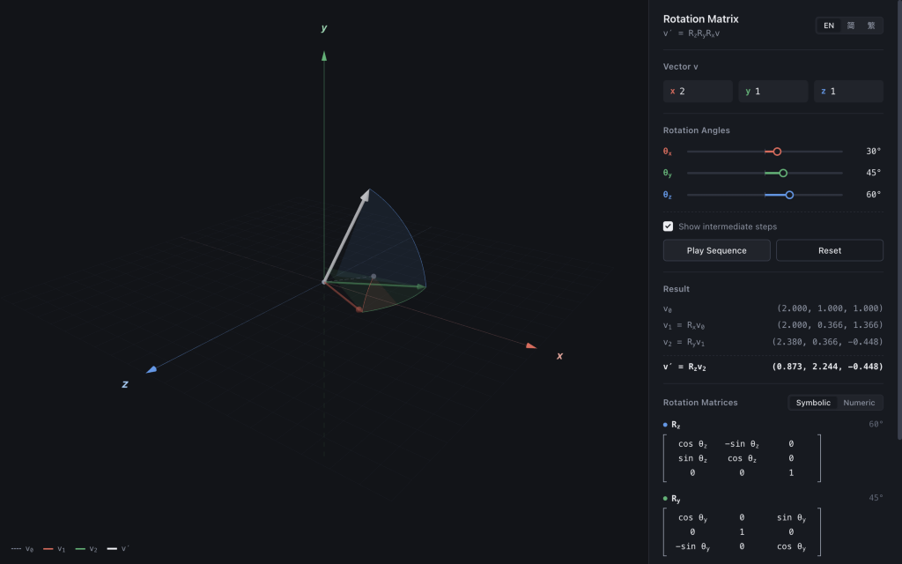
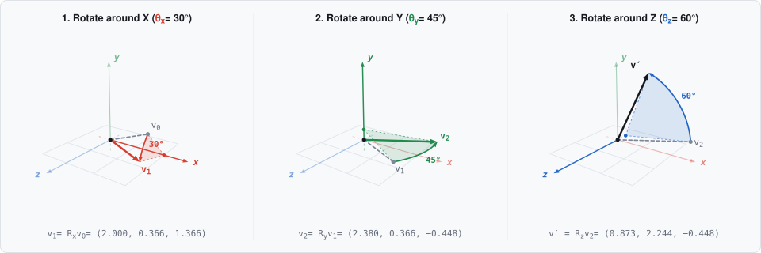

# Rotation-Matrix

Interactive 3D visualizer for fixed-axis Euler rotations in $\mathbb{R}^3$, applying elementary transforms around the world coordinate axes in sequence:

$$\mathbf{v}' = R_z(\theta_z)\, R_y(\theta_y)\, R_x(\theta_x)\, \mathbf{v}$$

<p align="center">
  
</p>

## Running

Open `Rotation-Matrix.html` directly in a modern browser, or serve the directory over HTTP:

```bash
python3 -m http.server
```

Three.js (`0.160.0`) and `OrbitControls` are loaded via an ES module import map from `cdn.jsdelivr.net`, so an active network connection is required on first load.

## Rotation Sequence

Each step rotates around a **fixed world axis** rather than a body-local axis—first around world $X$ by $\theta_x$, then world $Y$ by $\theta_y$, and finally world $Z$ by $\theta_z$. In column-vector convention, left-multiplication orders these matrices from right to left ($R = R_z R_y R_x$).

<picture>
  <source media="(prefers-color-scheme: dark)" srcset="assets/rotation-sequence-dark.svg">
  <source media="(prefers-color-scheme: light)" srcset="assets/rotation-sequence-light.svg">
  
</picture>

### Elementary Matrices

Positive angles follow the right-hand rule in a Y-up right-handed coordinate system: looking toward the origin along each positive axis, positive rotation turns counter-clockwise.

<picture>
  <source media="(prefers-color-scheme: dark)" srcset="assets/axis-convention-dark.svg">
  <source media="(prefers-color-scheme: light)" srcset="assets/axis-convention-light.svg">
  
</picture>

$$
R_x(\theta_x) = \begin{bmatrix}
1 & 0 & 0 \\
0 & \cos\theta_x & -\sin\theta_x \\
0 & \sin\theta_x & \cos\theta_x
\end{bmatrix},
\quad
R_y(\theta_y) = \begin{bmatrix}
\cos\theta_y & 0 & \sin\theta_y \\
0 & 1 & 0 \\
-\sin\theta_y & 0 & \cos\theta_y
\end{bmatrix},
\quad
R_z(\theta_z) = \begin{bmatrix}
\cos\theta_z & -\sin\theta_z & 0 \\
\sin\theta_z & \cos\theta_z & 0 \\
0 & 0 & 1
\end{bmatrix}
$$

Each matrix belongs to $SO(3)$ ($R^\mathsf{T} R = I$, $\det R = 1$), preserving vector length $\|\mathbf{v}'\| = \|\mathbf{v}\|$ at every intermediate step.

### Default State Walkthrough

For $\mathbf{v}_0 = (2, 1, 1)$ and $(\theta_x, \theta_y, \theta_z) = (30^\circ, 45^\circ, 60^\circ)$:

| Step | Expression | Coordinates | Norm |
| :--- | :--- | :--- | :--- |
| Initial | $\mathbf{v}_0$ | `(2.000, 1.000, 1.000)` | `2.449` |
| After $X$ | $\mathbf{v}_1 = R_x(30^\circ)\,\mathbf{v}_0$ | `(2.000, 0.366, 1.366)` | `2.449` |
| After $Y$ | $\mathbf{v}_2 = R_y(45^\circ)\,\mathbf{v}_1$ | `(2.380, 0.366, -0.448)` | `2.449` |
| Final | $\mathbf{v}' = R_z(60^\circ)\,\mathbf{v}_2$ | `(0.873, 2.244, -0.448)` | `2.449` |

## Controls

| Control | Behavior |
| :--- | :--- |
| **Language (`EN` / `简` / `繁`)** | Switch UI labels between English (default), Simplified Chinese, and Traditional Chinese (Hong Kong). |
| **3D Viewport** | Drag to orbit around the origin; scroll to zoom (`minDistance: 4`, `maxDistance: 30`). |
| **Vector `v`** | Edit `x`, `y`, `z` components directly (`step: 0.1`); updates the 3D scene and matrices live. |
| **Angles `θx`, `θy`, `θz`** | Drag sliders (`-180°` to `180°`) or click a degree readout to type an exact value (`Enter` to commit, `Esc` to cancel). |
| **Show Steps** | Toggle intermediate vectors (`v1`, `v2`), rotation arcs, and translucent sector planes. |
| **Play / Stop** | Animate from `0°` sequentially (`Rx → Ry → Rz` at `60°/s`) with a tip trajectory trail; clicking Stop restores target angles. |
| **Reset** | Reset `θx`, `θy`, `θz` to `0°` and clear the trail while keeping vector `v` intact. |
| **Symbolic / Numeric** | Toggle `Rz`, `Ry`, `Rx` display between trigonometric expressions and evaluated 3-decimal entries (`R` stays numeric). |

## Implementation Notes

- Delivered as a single self-contained HTML file (`Rotation-Matrix.html`) with no build step or bundler dependencies.
- Matrix composition uses `THREE.Matrix3`; rotation arcs and sector fans are constructed by projecting each intermediate vector onto the active world axis and sweeping along the orthogonal plane.
- Layout and 3D scene materials (background, fog, grid, axes, vectors, and sprite labels) adapt dynamically to `prefers-color-scheme`.
