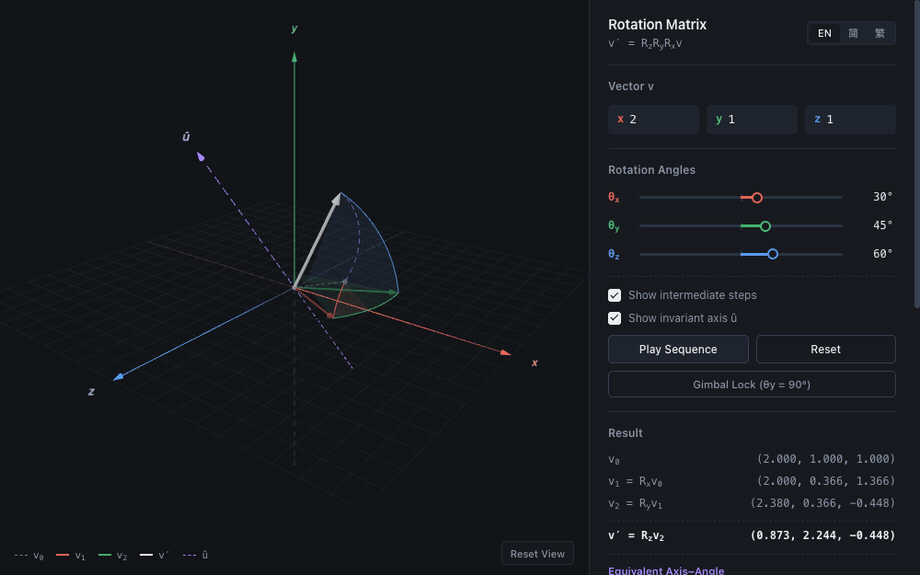
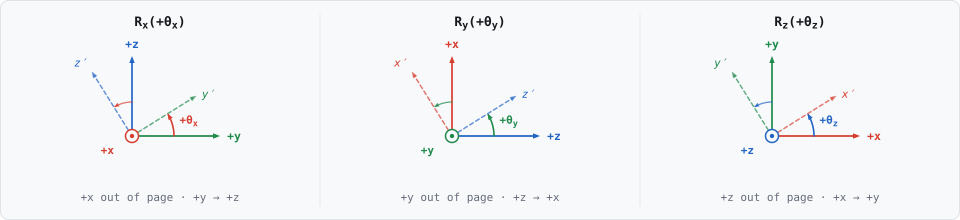

# Rotation-Matrix

**Live Demo:** [https://littlechocolate.github.io/Rotation-Matrix/](https://littlechocolate.github.io/Rotation-Matrix/)

Interactive 3D visualizer for fixed-axis Euler rotations in $\mathbb{R}^3$, applying elementary transforms around the world coordinate axes in sequence:

$$\mathbf{v}' = R_z(\theta_z)\, R_y(\theta_y)\, R_x(\theta_x)\, \mathbf{v}$$

<p align="center">
  <a href="https://littlechocolate.github.io/Rotation-Matrix/">
    
  </a>
</p>

## Motivation

When first learning linear transformations in 3D, two textbook facts tend to stay abstract until you watch them move: why column-vector composition $R_z R_y R_x$ applies $R_x$ first from right to left, and why any arbitrary sequence of world-axis rotations reduces to a single equivalent axis–angle pair $(\hat{\mathbf{u}}, \phi)$. I built this visualizer to inspect each intermediate vector, orthogonal rotation plane, and invariant axis simultaneously in 3D, and to make phenomena like Gimbal Lock ($\theta_y = \pm 90^\circ$) immediately visible rather than purely algebraic.

## Running Locally & Tests

Serve the repository root with any static HTTP server (browsers restrict ES module imports over `file://`):

```bash
python3 -m http.server
```

Run the pure-math unit test suite (Node.js 20+, zero npm dependencies):

```bash
npm test
```

Regenerate the four theme-aware SVG diagrams in `assets/`:

```bash
python3 scripts/gen_diagrams.py
```

Three.js (`0.160.0`) and `OrbitControls` are loaded via an import map from `cdn.jsdelivr.net`.

## Mathematical Model

### Rotation Sequence

Each step rotates around a **fixed world axis** rather than a body-local axis—first around world $X$ by $\theta_x$, then world $Y$ by $\theta_y$, and finally world $Z$ by $\theta_z$. Under column-vector convention, left-multiplication orders these matrices from right to left ($R = R_z R_y R_x$).

<picture>
  <source media="(prefers-color-scheme: dark)" srcset="assets/rotation-sequence-dark.svg">
  <source media="(prefers-color-scheme: light)" srcset="assets/rotation-sequence-light.svg">
  
</picture>

### Elementary Matrices

Positive angles follow the right-hand rule in a Y-up right-handed coordinate system: looking toward the origin along each positive axis, positive rotation turns counter-clockwise.

<picture>
  <source media="(prefers-color-scheme: dark)" srcset="assets/axis-convention-dark.svg">
  <source media="(prefers-color-scheme: light)" srcset="assets/axis-convention-light.svg">
  
</picture>

$$
R_x(\theta_x) = \begin{bmatrix}
1 & 0 & 0 \\
0 & \cos\theta_x & -\sin\theta_x \\
0 & \sin\theta_x & \cos\theta_x
\end{bmatrix},
\quad
R_y(\theta_y) = \begin{bmatrix}
\cos\theta_y & 0 & \sin\theta_y \\
0 & 1 & 0 \\
-\sin\theta_y & 0 & \cos\theta_y
\end{bmatrix},
\quad
R_z(\theta_z) = \begin{bmatrix}
\cos\theta_z & -\sin\theta_z & 0 \\
\sin\theta_z & \cos\theta_z & 0 \\
0 & 0 & 1
\end{bmatrix}
$$

Each matrix belongs to $SO(3)$ ($R^\mathsf{T} R = I$, $\det R = 1$), preserving vector length $\|\mathbf{v}'\| = \|\mathbf{v}\|$ at every intermediate step.

### Euler's Rotation Theorem & Gimbal Lock

By Euler's rotation theorem, the composite matrix $R = R_z R_y R_x \in SO(3)$ is equivalent to a single rotation by angle $\phi \in [0, \pi]$ about a fixed unit axis $\hat{\mathbf{u}}$ satisfying $R\hat{\mathbf{u}} = \hat{\mathbf{u}}$:

$$\cos\phi = \frac{\operatorname{tr}(R) - 1}{2}, \qquad \hat{\mathbf{u}} = \frac{1}{2\sin\phi} \begin{bmatrix} R_{32} - R_{23} \\ R_{13} - R_{31} \\ R_{21} - R_{12} \end{bmatrix}$$

When $\phi \to \pi$, $\sin\phi \to 0$ and the skew-symmetric axial term vanishes; in that half-turn regime, `extractAxisAngle` switches to extracting the unit eigenvector from the symmetric rank-1 projector $B = \frac{1}{4}(R + R^\mathsf{T}) + \frac{1}{2}I \approx \hat{\mathbf{u}}\hat{\mathbf{u}}^\mathsf{T}$.

At $\theta_y = \pm 90^\circ$ (**Gimbal Lock**), the world $X$ and $Z$ rotation planes align after the $Y$ turn, collapsing one rotational degree of freedom so $R$ depends only on $\theta_x - \theta_z$ (for $\theta_y = +90^\circ$) or $\theta_x + \theta_z$ (for $\theta_y = -90^\circ$).

### Default State Walkthrough

For $\mathbf{v}_0 = (2, 1, 1)$ and $(\theta_x, \theta_y, \theta_z) = (30^\circ, 45^\circ, 60^\circ)$:

| Step | Expression | Coordinates | Norm |
| :--- | :--- | :--- | :--- |
| Initial | $\mathbf{v}_0$ | `(2.000, 1.000, 1.000)` | `2.449` |
| After $X$ | $\mathbf{v}_1 = R_x(30^\circ)\,\mathbf{v}_0$ | `(2.000, 0.366, 1.366)` | `2.449` |
| After $Y$ | $\mathbf{v}_2 = R_y(45^\circ)\,\mathbf{v}_1$ | `(2.380, 0.366, −0.448)` | `2.449` |
| Final | $\mathbf{v}' = R_z(60^\circ)\,\mathbf{v}_2$ | `(0.873, 2.244, −0.448)` | `2.449` |

Equivalent single-axis representation: $\hat{\mathbf{u}} = (0.039,\, 0.773,\, 0.633)$, $\phi = 69.4^\circ$.

## Controls

| Control | Behavior |
| :--- | :--- |
| **Language (`EN` / `简` / `繁`)** | Switch UI labels between English (default), Simplified Chinese, and Traditional Chinese (Hong Kong). |
| **3D Viewport** | Drag to orbit around the origin; scroll to zoom dynamically scaled to vector magnitude. |
| **Reset View** | Re-center the camera on the origin and auto-fit distance for large vectors. |
| **Vector `v`** | Edit `x`, `y`, `z` components directly (`step: 0.1`); updates the 3D scene and matrices live. |
| **Angles `θx`, `θy`, `θz`** | Drag sliders (`−180°` to `180°`) or click/keyboard-activate a degree readout to enter an exact value. |
| **Show intermediate steps** | Toggle intermediate vectors (`v1`, `v2`), rotation arcs, and translucent sector planes. |
| **Show invariant axis û** | Toggle the composite Euler axis $\hat{\mathbf{u}}$ and the direct geodesic sweep from $\mathbf{v}_0$ to $\mathbf{v}'$. |
| **Play / Stop** | Animate sequentially from `0°` (`Rx → Ry → Rz` at `60°/s`) with a tip trail; disabled when all angles are `0°`. |
| **Reset** | Reset `θx`, `θy`, `θz` to `0°` and clear the trail while keeping vector `v` intact. |
| **Gimbal Lock (`θy = 90°`)** | Jump to `(30°, 90°, 60°)` and surface the algebraic degeneracy readout for $\theta_x \mp \theta_z$. |
| **Symbolic / Numeric** | Toggle `Rz`, `Ry`, `Rx` display between trigonometric expressions and evaluated 3-decimal entries (`R` stays numeric). |

## Design & Engineering Notes

- **Pure-Math / Scene Separation**: `src/math.js` has zero WebGL or Three.js dependencies, allowing `tests/math.test.js` (`node --test`) to verify $SO(3)$ orthogonality, norm preservation, half-turn axis extraction, and Gimbal Lock degeneracy in Node and GitHub Actions CI.
- **Singularity Guards**: Handles both the $\phi \to \pi$ axis-extraction singularity via symmetric projector column selection and the `dir = (0, −1, 0)` antiparallel singularity in `orientAlong` (`setFromAxisAngle(X, π)` instead of `setFromUnitVectors`).
- **Orthogonal Rotation Sectors & Z-Fighting Prevention**: Each step arc and translucent sector mesh projects the current vector onto the active world axis before sweeping, and intermediate vector meshes suppress automatically when coincident with $\mathbf{v}_0$, a prior step, or $\mathbf{v}'$.
- **WebGL Resource Management**: Dynamic arc and geodesic `BufferGeometry` instances call `.dispose()` before replacement, animation trails reuse a pre-allocated `Float32Array` buffer via `setDrawRange`, and fog/orbit limits scale automatically with vector length.
- **Reproducible Diagrams**: All four static vector illustrations in `assets/` are generated deterministically by `scripts/gen_diagrams.py` using the exact perspective math of the app.

## Project Layout

```text
.
├── .github/workflows/test.yml   # Node test runner CI
├── assets/                      # Demo GIF and theme-aware SVG diagrams
├── scripts/gen_diagrams.py      # Deterministic SVG diagram generator
├── src/
│   ├── i18n.js                  # EN / zh-CN / zh-HK string dictionary
│   ├── main.js                  # Entry point & animation loop
│   ├── math.js                  # Pure SO(3), Euler axis-angle & Gimbal Lock math
│   ├── scene.js                 # Three.js scene, vectors, arcs, sectors & theme sync
│   └── ui.js                    # DOM state bindings & controls
├── tests/math.test.js           # Automated unit tests (node --test)
├── index.html                   # App shell (served at root for GitHub Pages)
├── styles.css                   # Light/dark engineering layout & controls
├── package.json                 # ES module config & test script
└── LICENSE                      # MIT License
```
